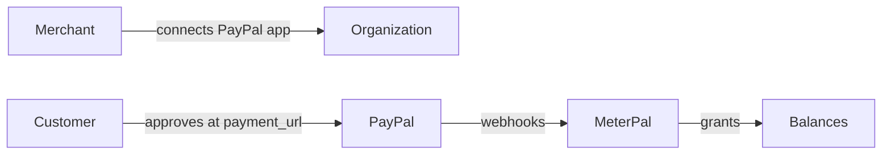

MeterPal is PayPal-only: every checkout, subscription and auto top-up is settled through your organization's own PayPal account. There is no other processor to configure.

## Connecting your PayPal account

Each organization connects its own PayPal REST app per environment (sandbox and live are stored independently). The connection lives in the org config and is managed with:

- `POST /v1/organization/paypal` — body: `client_id` (required), `client_secret` (required), `webhook_id` (optional). MeterPal verifies the credentials against PayPal **before** storing them, so a broken client id fails at connect time rather than at checkout time.
- `GET /v1/organization/paypal` — returns the current connection for the active environment (account email, webhook id, connection state).
- `DELETE /v1/organization/paypal` — disconnects only this environment's connection; the other environment is untouched.

The PayPal environment follows the billing environment: a sandbox org key connects a sandbox PayPal app, and a live key connects a live one. A test checkout can therefore never create a live PayPal subscription.

When you connect, MeterPal also auto-registers its webhook URL on your PayPal app (best-effort — if registration fails, the dashboard still shows the URL so you can register it manually and paste the webhook id).

## Checkout

Checkout goes through the same billing endpoints as everything else (`billing.attach`, `billing.checkout`, SDK checkout components). MeterPal returns a `payment_url` and the buyer approves there:

- **One-off purchases** (credit packs) create a PayPal **Orders v2** order with `CAPTURE` intent in USD. The buyer approves at the returned PayPal link and the order is captured server-side, which credits the customer's wallet.
- **Recurring plans** create a PayPal **Subscription** backed by a billing plan in your PayPal catalog. MeterPal maps each MeterPal plan to a PayPal product + billing plan (cached per org/environment, automatically re-synced when the plan's price changes), so buyers always see the current price. Plan changes *revise* the existing subscription instead of creating a second one, so a customer is never billed twice; moving to a free plan cancels the paid subscription and attaches directly.
- After approval, PayPal redirects the buyer back to MeterPal's return route, which captures the order or activates the subscription. Webhook events close the loop independently of the browser redirect, so a lost redirect never loses a payment.

## Webhooks

MeterPal receives PayPal events at:

- `POST /webhooks/paypal/:orgId/:webhookId` — the merchant-pasted form; the id in the URL names the org's PayPal connection.
- `POST /webhooks/paypal/:orgId` — the URL created by webhook auto-registration (the environment is resolved by matching the org's stored webhook ids against the signature).
- `POST /webhooks/paypal` — single-tenant setups with one process-wide webhook id.

Every delivery is signature-verified against the org's webhook id before processing. Events MeterPal handles:

| Category | Events |
|----------|--------|
| Subscription lifecycle | `BILLING.SUBSCRIPTION.CREATED`, `ACTIVATED`, `RE-ACTIVATED`, `UPDATED`, `SUSPENDED`, `CANCELLED`, `EXPIRED`, `PAYMENT.FAILED` |
| Payments | `PAYMENT.SALE.COMPLETED`, `PAYMENT.SALE.REFUNDED`, `PAYMENT.SALE.REVERSED`, `PAYMENT.CAPTURE.COMPLETED`, `PAYMENT.CAPTURE.REFUNDED`, `PAYMENT.CAPTURE.REVERSED` |
| Disputes | `CUSTOMER.DISPUTE.CREATED`, `CUSTOMER.DISPUTE.UPDATED`, `CUSTOMER.DISPUTE.RESOLVED` |
| Overage invoices | `INVOICING.INVOICE.PAID` |
| Checkout signal | `CHECKOUT.ORDER.APPROVED` |

Handlers are idempotent on the PayPal event id, and a `5xx` response triggers PayPal's retry policy (25 retries over 3 days), so a transient failure is retried rather than dropped. Webhook handlers read the `custom_id` MeterPal writes on orders (`mp:<customer_id>:<product_id>`) and subscriptions, so credits always land on the right customer without relying on emails.

## Auto top-ups

When a balance crosses its auto top-up threshold, MeterPal charges the customer's **vaulted PayPal billing agreement** — a `BA-` token approved alongside their subscription — with a merchant-initiated Orders v2 transaction. No buyer presence, redirect or approval link is involved, and the wallet is credited by the captured amount. Success and failure are surfaced to you through the `billing.auto_topup_succeeded` and `billing.auto_topup_failed` webhooks.

## Overage invoices

For usage overage you can bill through PayPal invoicing instead of an immediate charge: `POST /v1/overage_invoices` creates and emails a PayPal invoice to the customer (an email is required). When the buyer pays, the `INVOICING.INVOICE.PAID` webhook credits their wallet — idempotent on the invoice id, so retries never double-credit.
